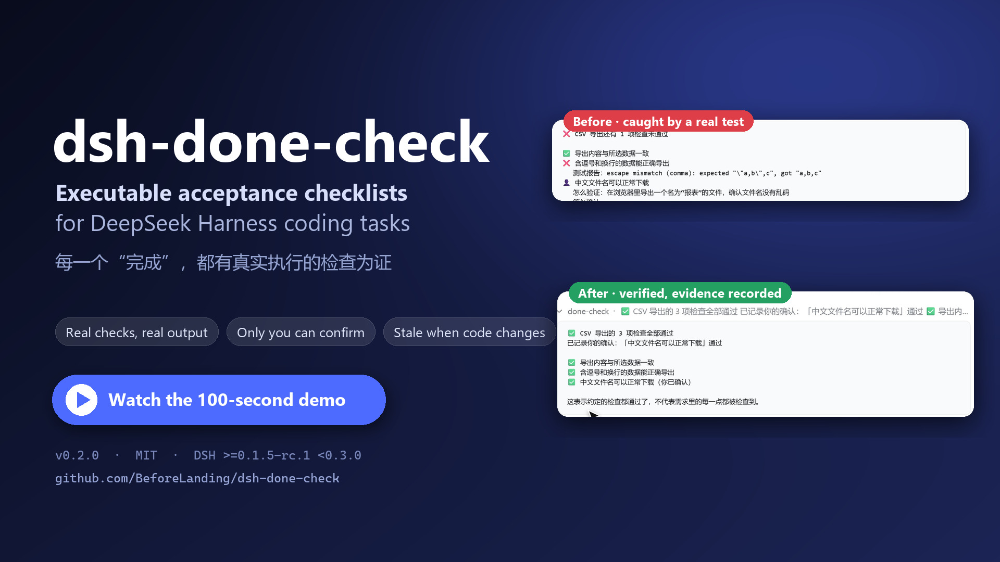
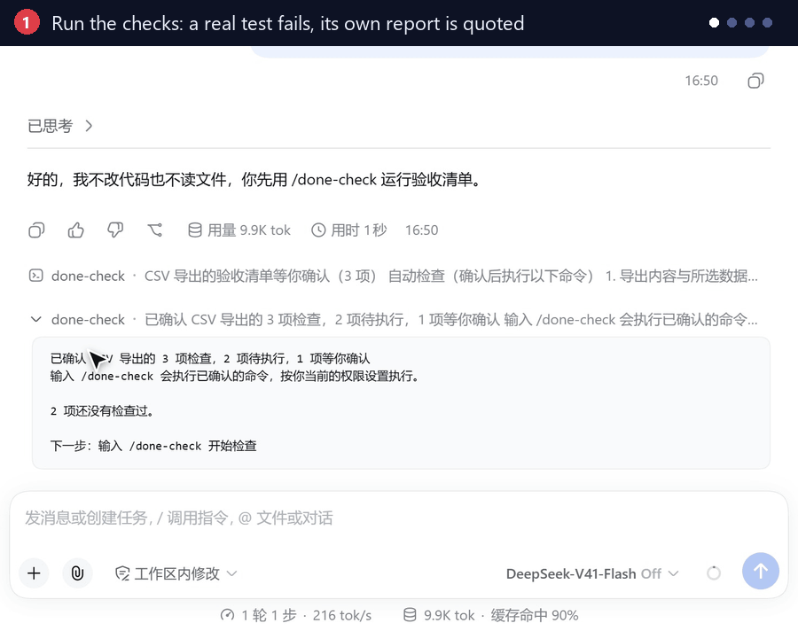

<p align="center">
  
</p>

<h1 align="center">dsh-done-check</h1>

<p align="center">Executable acceptance checks for <a href="https://github.com/deepseek-ai/deepseek-harness">DeepSeek Harness</a>.</p>

<p align="center">
  <a href="https://www.npmjs.com/package/dsh-done-check"></a>
  <a href="https://github.com/BeforeLanding/dsh-done-check/actions/workflows/ci.yml"></a>
  <a href="https://github.com/BeforeLanding/dsh-done-check/blob/main/LICENSE"></a>
</p>

<p align="center">English · <a href="README.zh-CN.md">简体中文</a><br>
<a href="#install">Install</a> · <a href="#walkthrough">Watch demo</a> · <a href="#quick-start">Quick start</a> · <a href="#try-the-example">Runnable example</a></p>

Keep a task's agreed checks in `done-check.yaml`. The plugin runs them through DSH, records the command and its result, and marks old results for re-checking when the watched files change. You confirm the checklist and decide the manual items.

## Install

Requires **DSH `>=0.1.5-rc.1 <0.3.0`**, **Node.js `>=22.19`**, and a **git project**.

```bash
dsh plugin --profile web add dsh-done-check
```

**The new initialization and English-output commands are in the v0.2.1 source. Until that npm release is published, use [source installation](https://github.com/BeforeLanding/dsh-done-check/blob/main/docs/USAGE.md#install) to try them.**

For another CLI-managed profile, replace `web` with its name. Follow your host's reload or restart prompt. [Install from source](https://github.com/BeforeLanding/dsh-done-check/blob/main/docs/USAGE.md#install).

## Walkthrough

Follow the actual commands: preview the list, confirm, inspect a CSV failure, verify the fix, record a manual check, and revisit results after an edit.

<p align="center">
  <a href="https://youtu.be/CJw7eL7v4bw"></a>
</p>

<p align="center"><a href="https://youtu.be/CJw7eL7v4bw"><strong>▶ Watch on YouTube · 1:12 · 1080p</strong></a><br>
Chinese narration · English and Chinese captions<br>
<a href="https://raw.githubusercontent.com/BeforeLanding/dsh-done-check/main/docs/video/walkthrough.mp4">Download MP4</a> · <a href="https://github.com/BeforeLanding/dsh-done-check/blob/main/docs/video/README.md">Chapters, transcript and source footage</a></p>

<details>
<summary>18-second preview (GIF)</summary>

<p align="center">
  
</p>
<p align="center"><sub>18-second edit of a real DSH session. Chinese UI, bilingual step labels.<br><a href="https://youtu.be/CJw7eL7v4bw">Full video on YouTube</a> · <a href="https://raw.githubusercontent.com/BeforeLanding/dsh-done-check/main/docs/images/hero-poster.png">View a still image</a></sub></p>

</details>

## Quick start

**1. Add a checklist at the git root.** Create a draft in your DSH chat:

```text
/done-check lang en
/done-check init
```

Review the detected project scripts and replace the manual-review instructions with concrete acceptance steps. Initialization never executes commands, confirms a checklist or overwrites an existing one. You can also ask the agent:

> Draft and save done-check.yaml for this task. Use the project's actual test commands and name what each one verifies. Add a manual item with instructions for anything I need to inspect myself.

Or [write the YAML yourself](https://github.com/BeforeLanding/dsh-done-check/blob/main/docs/USAGE.md#write-a-checklist).

**2. Preview, confirm, run.** Send these as three separate messages in your project's DSH chat:

```text
/done-check
/done-check confirm
/done-check
```

The first command shows the checklist and commands without running them. `confirm` records your acceptance of that exact preview. The next `/done-check` runs the automatic checks.

**3. Act on the result.** Read a failed test's report, ask the agent to fix the problem, then run `/done-check` again. For a manual item, follow its instructions and record `/done-check ok [n]` or `/done-check no [n] [note]`. Omit `n` when only one manual item is waiting.

Output defaults to Chinese. Use `/done-check lang en` or `/done-check lang zh` for the current session. Commands accept both languages, including `confirm` / `确认` and `details` / `详情`. Test reports, task names and your instructions are preserved as written.

## Try the example

The [CSV export example](https://github.com/BeforeLanding/dsh-done-check/tree/main/examples/csv-export) includes a deliberately broken exporter, two executable checks, a manual check and a supplied fix. It needs only Node.js and git; no dependency installation or API key is needed to run its tests.

<details>
<summary>Clone and create a standalone demo</summary>

```bash
git clone https://github.com/BeforeLanding/dsh-done-check.git
cd dsh-done-check
node examples/csv-export/demo.mjs setup
```

</details>

The setup command prints a new standalone git directory and the next commands. Open a DSH session there, then follow the example's README to reproduce **failure → fix → pass → stale**. If you already have this checkout, only run the setup command. The example is a reproducible companion to the recorded CSV scenario; the video uses the original session footage.

## What a result tells you

- **Passed or failed:** the command actually ran. Its exit code, output, duration and file-content fingerprint are recorded.
- **Not run:** permission denial, timeout or an executor problem prevented a usable result. It is neither a pass nor a failure.
- **Waiting for you:** a manual item needs your verdict. The agent cannot confirm a checklist or record a manual decision.
- **Needs re-checking:** the watched files differ from the ones behind the saved result. Changing a check definition or the checklist structure requires confirmation again.

> A pass means the **agreed checks** passed. It does not mean every requirement was covered. The plugin does not report a completion percentage.

Without `watch`, the fingerprint covers tracked and non-ignored untracked files, excluding the checklist. With `watch`, it covers the declared matching files. Include relevant configuration and lockfiles; the plugin does not infer dependencies. [File watching and trust limits](https://github.com/BeforeLanding/dsh-done-check/blob/main/docs/USAGE.md#watch-the-right-files).

## Reference

- `/done-check status` — read the current status without running checks.
- `/done-check details [n]` — inspect commands, output and changed files.
- `/done-check run` — force a re-run of all confirmed automatic checks, including unchanged failed ones.
- [All commands and agent tools](https://github.com/BeforeLanding/dsh-done-check/blob/main/docs/USAGE.md#command-reference) · [Checklist format](https://github.com/BeforeLanding/dsh-done-check/blob/main/docs/USAGE.md#write-a-checklist) · [中文指南](https://github.com/BeforeLanding/dsh-done-check/blob/main/docs/USAGE.zh-CN.md)

Checklist confirmation does not bypass DSH command permissions. Checks use your registered shell tool; local executors provide no isolation. This guards against casual changes to checks and verdicts, not an agent with unrestricted shell access. [Trust model](https://github.com/BeforeLanding/dsh-done-check/blob/main/docs/USAGE.md#trust-and-limits).

## Development

```bash
pnpm install
pnpm typecheck
pnpm build
pnpm test
```

**v0.2.1 source, npm release pending.** Verified on real DSH Web `0.1.5-rc.1` and `0.2.1-rc.5`, with the real `pwsh` tool in its sandbox. See the [changelog](CHANGELOG.md), [design notes (Chinese)](https://github.com/BeforeLanding/dsh-done-check/blob/main/docs/DESIGN.md) and [media build instructions](https://github.com/BeforeLanding/dsh-done-check/blob/main/docs/video/README.md).

## License

[MIT](LICENSE)
