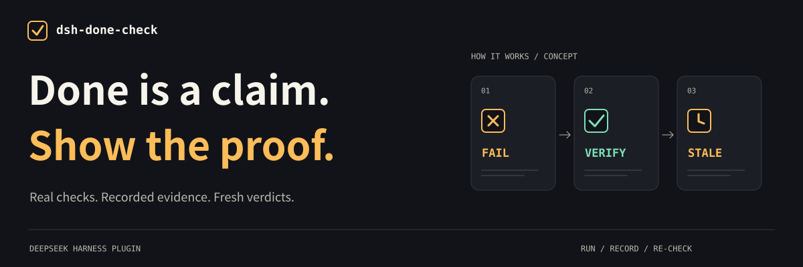
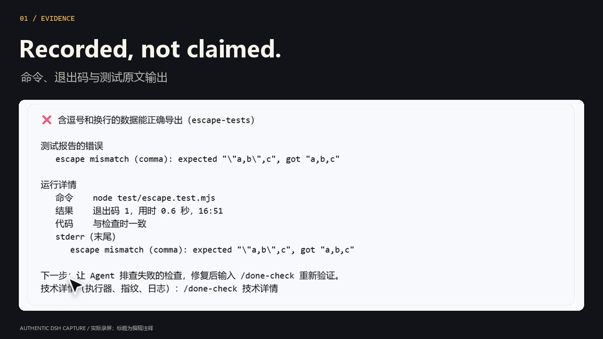
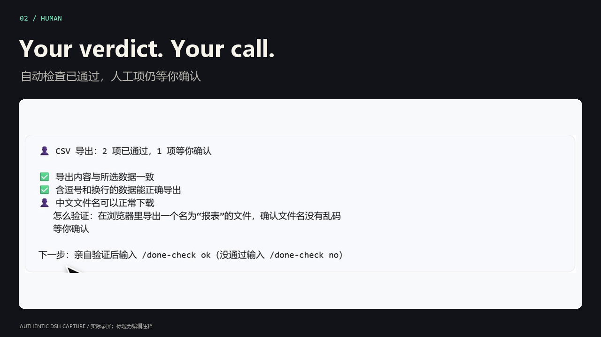
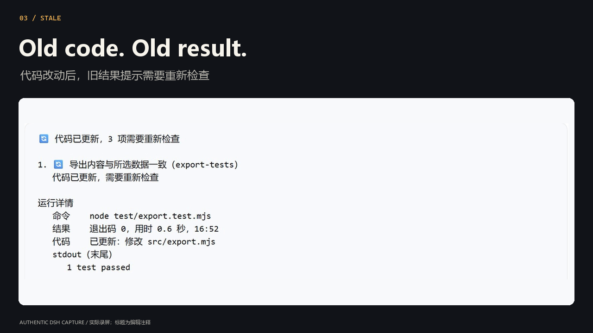

<p align="right"><strong>English</strong> · <a href="README.zh-CN.md">简体中文</a></p>

<p align="center">
  
</p>

<p align="center">
  <a href="https://www.npmjs.com/package/dsh-done-check"></a>
  <a href="https://github.com/BeforeLanding/dsh-done-check/actions/workflows/ci.yml"></a>
  <a href="https://github.com/BeforeLanding/dsh-done-check/blob/main/LICENSE"></a>
</p>

<p align="center">
  <strong>Acceptance checks that run inside <a href="https://github.com/deepseek-ai/deepseek-harness">DeepSeek Harness</a>.<br>Real commands. Recorded evidence. Your final say.</strong>
</p>

<p align="center"><a href="#start-checking">Install &amp; use</a> · <a href="#watch-the-story">Watch the demo</a> · <a href="https://github.com/BeforeLanding/dsh-done-check/blob/main/docs/USAGE.md">User guide</a></p>

<p align="center">
  
</p>
<p align="center"><sub>One CSV bug. Real DSH output. A result you can inspect.<br>16-second preview · <a href="https://raw.githubusercontent.com/BeforeLanding/dsh-done-check/main/docs/images/hero-poster.png">Still image</a> · Chinese UI, bilingual captions</sub></p>

<table>
  <tr>
    <td width="33%" valign="top"><strong>01 / Run it.</strong><br><br>A real command produces the result. Failed tests quote their own report; commands that could not run say so.</td>
    <td width="33%" valign="top"><strong>02 / Own the verdict.</strong><br><br>The agent drafts and checks. You confirm the checklist and decide the manual items.</td>
    <td width="33%" valign="top"><strong>03 / Keep it current.</strong><br><br>Change the watched code and the old result needs another check. Yesterday's evidence stays tied to yesterday's files.</td>
  </tr>
</table>

## Start checking

**DSH `>=0.1.5-rc.1 <0.3.0` · Node.js `>=22.19` · git project**

For a `dsh web` profile:

```bash
dsh plugin --profile web add dsh-done-check
```

Use your active profile name in place of `web` if it differs. In your project's DSH chat, ask:

> Draft and save done-check.yaml for this task. Use this project's real tests and commands, name the behaviours they verify, and add a manual item with a how for anything I must inspect myself. Let me preview and confirm the checklist.

Then send these separately:

1. **Preview** — `/done-check` shows the checklist and commands. Nothing runs.
2. **Confirm** — `/done-check confirm` accepts exactly the checklist you saw.
3. **Check** — `/done-check` runs the automatic checks and shows what needs attention.

Ask the agent to fix a failing check's underlying bug, then check again. Inspect manual items yourself and record `/done-check ok [n]` or `/done-check no [n] [note]`. If only one manual item is waiting, omit `n`.

[Write a checklist yourself →](https://github.com/BeforeLanding/dsh-done-check/blob/main/docs/USAGE.md#write-a-checklist)

## Watch the story

**Done needs proof. Start with a real test.** A CSV escaping bug becomes a recorded failure, a verified fix, and a manual verdict that expires after a code edit.

<p align="center">
  <a href="https://github.com/BeforeLanding/dsh-done-check/blob/main/docs/video/dsh-done-check-film.mp4"></a>
</p>

<p align="center"><strong><a href="https://github.com/BeforeLanding/dsh-done-check/blob/main/docs/video/dsh-done-check-film.mp4">▶ Watch the film · 1:04 · 1080p</a></strong><br>Chinese narration · bilingual subtitles · real session footage<br><a href="https://raw.githubusercontent.com/BeforeLanding/dsh-done-check/main/docs/video/dsh-done-check-film.mp4">Download MP4</a> · <a href="https://github.com/BeforeLanding/dsh-done-check/blob/main/docs/video/README.md">Transcript &amp; source footage</a></p>

## Read the result, not the promise

The output tells you **what was checked, what still needs attention, and what to do next**. Details keep the command, exit code, output, time and content fingerprint behind each automatic result.

<details>
<summary><strong>Open the evidence gallery — failure, human acceptance, stale result</strong></summary>

**A failure with its own report.** Read the command and recorded output with `/done-check details`.



**A decision the agent cannot make for you.** Automatic checks can pass while a manual item still waits for your verdict.



**A result that knows when it is old.** In this recorded scene, three old results need re-checking. The previous exit code is still there as history, alongside the changed source file.



</details>

> Passing means **the agreed checks passed**. It does not mean every requirement was tested. There is no completion percentage.

## Go deeper

- **[User guide](https://github.com/BeforeLanding/dsh-done-check/blob/main/docs/USAGE.md)** — checklist YAML, file watching, manual checks and source installation.
- **[Command reference](https://github.com/BeforeLanding/dsh-done-check/blob/main/docs/USAGE.md#command-reference)** — status, evidence, re-runs and agent tools.
- **[Trust model](https://github.com/BeforeLanding/dsh-done-check/blob/main/docs/USAGE.md#trust-and-limits)** — confirmation, permissions, content fingerprints and unstable runs.
- **[Design notes (中文)](https://github.com/BeforeLanding/dsh-done-check/blob/main/docs/DESIGN.md)** · **[Changelog](CHANGELOG.md)** — implementation and release history.

Checklist confirmation does not authorize commands: execution follows your DSH shell tool's permission rules. Local executors provide no isolation. The plugin guards against casual changes to checks and verdicts, not a malicious agent with unrestricted shell access.

**v0.2.0 · early release.** Verified on real DSH Web `0.1.5-rc.1` and `0.2.1-rc.5`, using the real `pwsh` tool in its sandbox. Plugin output is currently Chinese; English command aliases are supported.

For development: `pnpm install`, then `pnpm typecheck && pnpm build && pnpm test`. See the [media build guide](https://github.com/BeforeLanding/dsh-done-check/blob/main/docs/video/README.md) to reproduce the visuals and film.

---

[MIT](LICENSE) · Built by [BeforeLanding](https://github.com/BeforeLanding)
