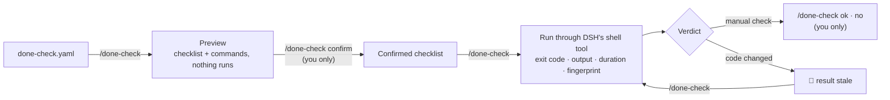

<div align="center">

# dsh-done-check

**Don't trust "done" — trust the check that ran.**

Executable acceptance checklists for [DeepSeek Harness](https://github.com/deepseek-ai/deepseek-harness) coding tasks: every "done" is backed by a check that actually ran, and old results are flagged for re-check as soon as the code changes.

[](https://github.com/BeforeLanding/dsh-done-check/actions/workflows/ci.yml)
[](https://www.npmjs.com/package/dsh-done-check)
[](LICENSE)
[](https://github.com/deepseek-ai/deepseek-harness)
[](package.json)

English · [简体中文](README.zh-CN.md)


<sub>A real bug, caught by a real test: <code>/done-check</code> runs the confirmed checks and quotes the failing report as-is.<br>The full fix-and-verify loop is in the video below. Recorded in a live DSH web session (status messages are currently in Chinese only).</sub>

</div>

---

## Demo video

<div align="center">

<a href="https://youtu.be/kIWweTUUfP0"></a>

</div>

The full flow in under two minutes, 1080p, in one real session: **preview → confirm → run → inspect the evidence → agent fixes the code → re-run → manual confirmation → results go stale after an edit**. Prefer a file? [Download the MP4](docs/video/dsh-done-check-demo.mp4).

## Highlights

- **A "done" needs a receipt.** Each check runs for real and records its exit code, output, duration and a fingerprint of the workspace at that moment.
- **Failures are quoted, not interpreted.** A failed check shows up to three lines of the test's own output as the "test report". The plugin draws no conclusion from them.
- **The agent cannot grade its own work.** Confirming the checklist and recording manual verdicts can only come from you. The agent can draft, run and read status, but confirmation and manual verdicts are yours, and editing or removing a check forces you to re-confirm.
- **Results expire with the code.** Any change to the workspace (uncommitted edits included) turns results bound to the old content into `🔄 code changed, re-check`; editing a check asks you to re-confirm.
- **One command covers the main path.** `/done-check` does the next thing that is due: preview, run, or show the verdict.
- **Honest about what it did not run.** A check that could not run (permission denied, timeout, executor error) is `⚠️ not run`, never a failure and never a pass.

## Quick start

**Requirements:** DSH `>=0.1.5-rc.1 <0.3.0`, Node.js `>=22.19`, and git.

```bash
dsh plugin --profile <your-profile> add dsh-done-check
```

From a checkout: `pnpm install && pnpm build`, then `dsh plugin --profile <your-profile> add /path/to/dsh-done-check`.

Then, in a DSH chat:

1. Put a `done-check.yaml` in the project root (or let the agent draft it) — see [How it works](#how-it-works).
2. `/done-check` to preview, `/done-check 确认` to confirm, `/done-check` to run.

## What it can and cannot tell you

> [!IMPORTANT]
>
> - A summary such as "3 checks: 2 passed, 1 awaiting manual confirmation" covers **only the agreed checks**. It does not mean the requirement is fully implemented. The plugin never shows a percentage or a "completion" score.
> - It guards against an agent casually rewriting the verdict: claiming tests passed, quietly changing a check command, deleting a failing check, or forging a confirmation. It does not stop a malicious agent with an unrestricted shell, which can edit the tests themselves or the files under DSH home.
> - Confirming a checklist does not authorize running its commands. Checks run on the shell executor of the current DSH composition; `bash-local` / `pwsh-local` provide no isolation, so compose the matching sandbox executor if you need it.
> - `watch` is a scope you declare, not a dependency graph inferred for you.

## Commands and tools

One command covers the main path: **`/done-check` does the next thing that is due** — preview the checklist, run the checks, or show the verdict. Status messages are currently in Chinese only.

| | Who | What |
|---|---|---|
| `/done-check` | you | Not confirmed yet → shows the checklist **and the commands it will run**, runs nothing. Confirmed → runs the checks that were never run or whose code changed, then shows the summary. |
| `/done-check 确认` (`confirm`) | **you only** | Confirm the checklist you were just shown. Only works on the exact list from the last preview; otherwise it shows the preview again. |
| `/done-check ok [n]` / `no [n] [note]` | **you only** | Record the result of a manual check. With one manual check waiting, no number is needed. |
| `/done-check 详情 [n]` (`details`) | you | Command, exit code, time, output tail, changed files |
| `/done-check 全部` (`all`) | you | Every check, passing ones included |
| `/done-check 技术详情 [n]` (`tech`) | you | Executor and sandbox, full fingerprint, definition hash, log path |
| `/done-check 重新检查` (`run`) | you | Force-run every automatic check |
| `done_check_draft` | Agent | Validate a drafted checklist (the Agent saves it with its own file tool) |
| `done_check_run` | Agent | Run the confirmed automatic checks |
| `done_check_status` | Agent | Read the status (returns `verdict` and `nextStep`) |

`n` is the check's position in the summary; the internal id still works. `show`, `pass` and `fail` remain as aliases for one more version.

Output answers three questions: what was checked, what is still wrong, what to do now. The first line is always a complete conclusion, for example `❌ CSV 导出还有 1 项检查未通过`. A failed check quotes up to three lines of the test's own output as "测试报告" — the plugin draws no conclusion from them. A check that could not run (permission denied, timeout, executor error) is reported as `⚠️ 没能运行`, never as a failure and never as a pass.

**Confirming is not authorizing.** Typing `/done-check` after confirming executes the confirmed commands, through your session's normal permission rules. Every command goes to the shell tool registered in your DSH composition (`pwsh`/`bash`), so your approval prompts apply; a refused command leaves no evidence.

## How it works



1. Write `done-check.yaml` in the project root (or let the Agent draft it). Name each check by something you can judge, and give manual checks a `how`:

   ```yaml
   version: 1
   task: CSV 导出
   checks:
     - id: export-tests
       name: 导出内容与所选数据一致
       run: node test/export.test.mjs
       watch: ["src/**", "test/**"]
     - id: escape-tests
       name: 含逗号和换行的数据能正确导出
       run: node test/escape.test.mjs
       watch: ["src/**", "test/**"]
     - id: zh-filename
       name: 中文文件名可以正常下载
       manual: true
       how: 在浏览器里导出一个名为“报表”的文件，确认文件名没有乱码
   ```

2. `/done-check` previews it; you confirm with `/done-check 确认`. Confirmation and manual verdicts can only come from you, never from the Agent.
3. Checks run through DSH's shell tool; exit code, output, duration and a fingerprint of the workspace at that moment are recorded.
4. Any change to the workspace (uncommitted edits included) turns results bound to the old content into `🔄 代码已更新，需要重新检查`, and lists the changed files in the details. Editing a check makes it `✏️` and asks you to re-confirm; adding or removing checks or rewording the task asks you to re-confirm the whole list.
5. A result whose run saw the workspace or definition change is `🔄 检查时代码正在变化，结果不可信`; restoring the files does not revive it.

## Status

v0.2.0, an early release. v0.2 redesigns only what you read and type; the verification rules are unchanged. The new output was checked on real DSH web hosts (0.1.5-rc.1 and 0.2.1-rc.5), with checks executed by the real `pwsh` tool inside its sandbox. Supported DSH: `>=0.1.5-rc.1 <0.3.0`. Design: [docs/DESIGN.md](https://github.com/BeforeLanding/dsh-done-check/blob/main/docs/DESIGN.md) (in Chinese). See the [CHANGELOG](CHANGELOG.md) for release notes.

## Development

```bash
pnpm install
pnpm test
```

Requires Node.js ≥ 22.19 and git.

## License

MIT
