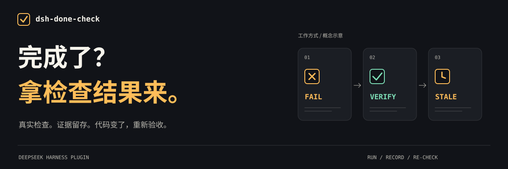
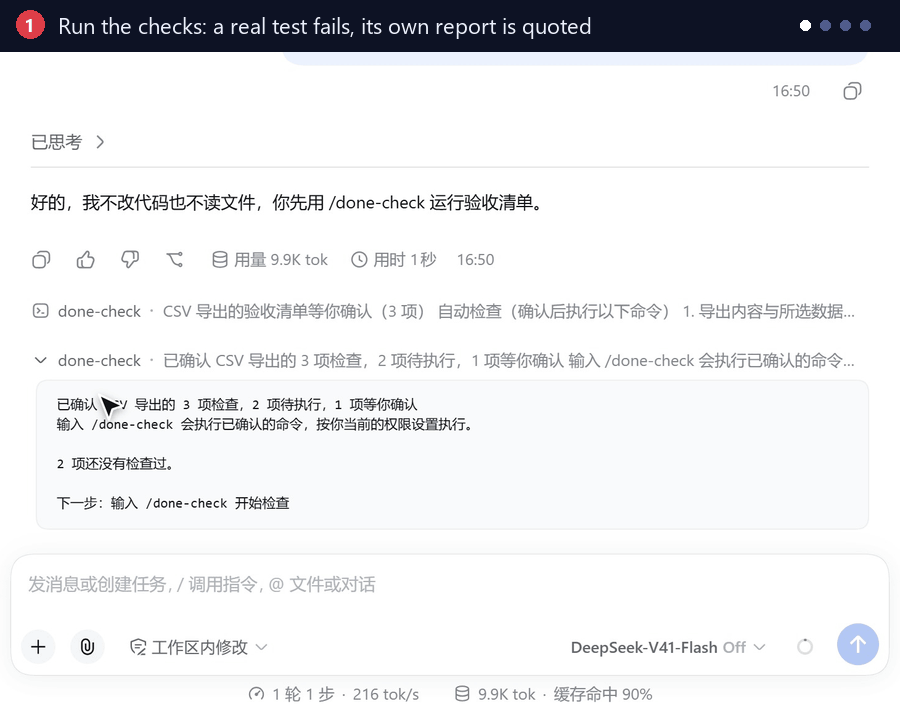
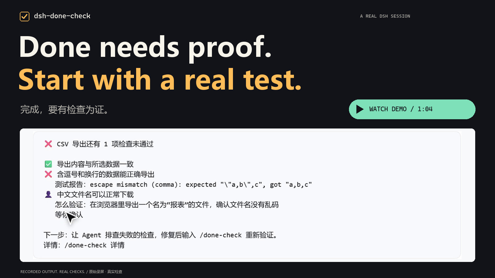
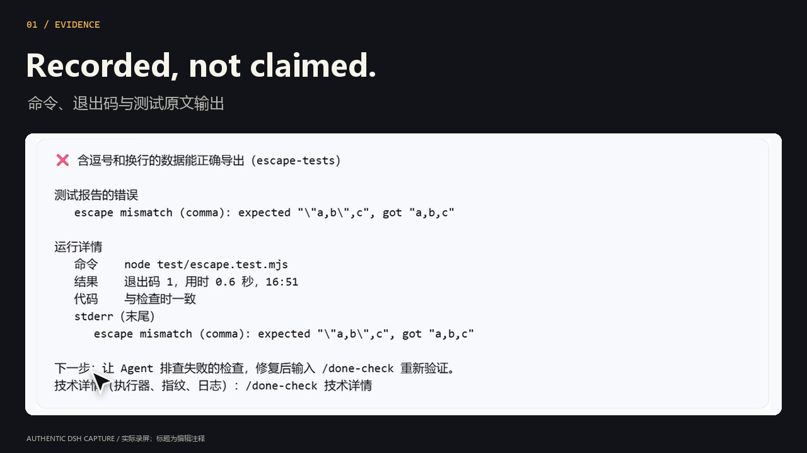
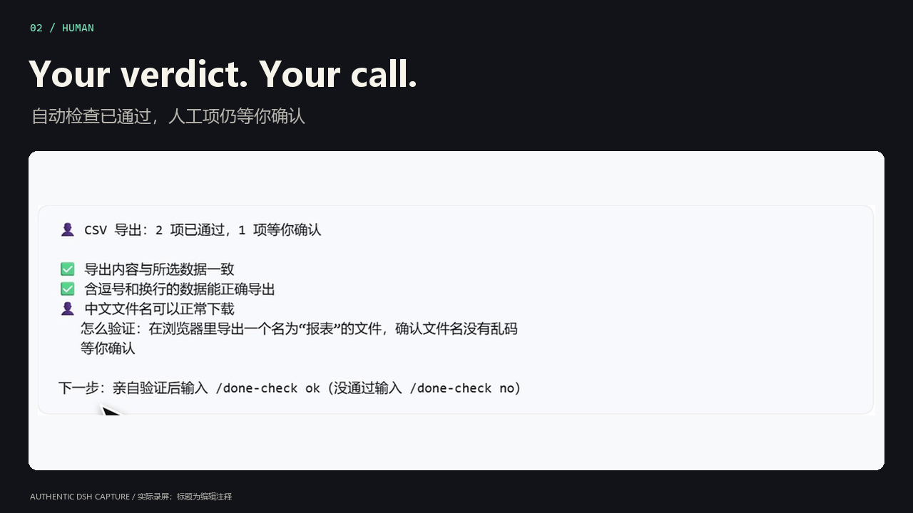
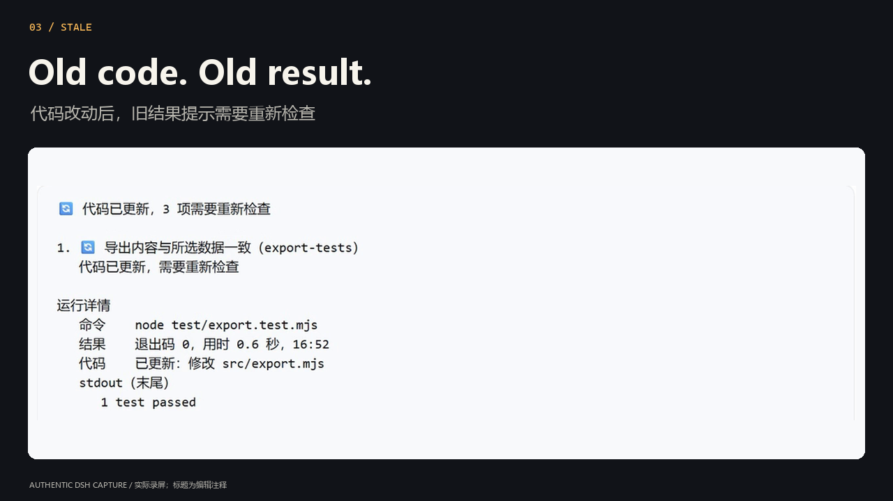

<p align="right"><a href="README.md">English</a> · <strong>简体中文</strong></p>

<p align="center">
  
</p>

<p align="center">
  <a href="https://www.npmjs.com/package/dsh-done-check"></a>
  <a href="https://github.com/BeforeLanding/dsh-done-check/actions/workflows/ci.yml"></a>
  <a href="https://github.com/BeforeLanding/dsh-done-check/blob/main/LICENSE"></a>
</p>

<p align="center">
  <strong>在 <a href="https://github.com/deepseek-ai/deepseek-harness">DeepSeek Harness</a> 里执行验收检查。<br>命令真实运行，证据随时可查，验收由你决定。</strong>
</p>

<p align="center"><a href="#开始验收">安装使用</a> · <a href="#看一个完整故事">观看演示</a> · <a href="https://github.com/BeforeLanding/dsh-done-check/blob/main/docs/USAGE.zh-CN.md">使用指南</a></p>

<p align="center">
  
</p>
<p align="center"><sub>一个 CSV bug，一场真实会话，一份可查的验收结果。<br>16 秒预览 · <a href="https://raw.githubusercontent.com/BeforeLanding/dsh-done-check/main/docs/images/hero-poster.png">静态图</a> · 中文界面，双语字幕</sub></p>

<table>
  <tr>
    <td width="33%" valign="top"><strong>01 / 真正跑一遍。</strong><br><br>真实命令给出结果。失败就引用测试自己的报告；没能运行，就明确说没能运行。</td>
    <td width="33%" valign="top"><strong>02 / 验收权在你。</strong><br><br>Agent 起草清单、执行检查。你确认约定的内容，亲自决定人工项是否通过。</td>
    <td width="33%" valign="top"><strong>03 / 代码变，重验收。</strong><br><br>关注的文件一变，旧结果就提示重验。昨天的证据，只对应昨天的文件。</td>
  </tr>
</table>

## 开始验收

**DSH `>=0.1.5-rc.1 <0.3.0` · Node.js `>=22.19` · git 项目**

使用 `dsh web` profile 时：

```bash
dsh plugin --profile web add dsh-done-check
```

如果你使用其他 profile，把 `web` 换成当前名称。在项目的 DSH 对话里发送：

> 为当前任务起草并保存 done-check.yaml。使用这个项目里真实存在的测试和命令，名称写清能验证的行为；需要我亲自检查的内容写成人工项，附上 how。让我先预览，再确认清单。

然后逐条操作：

1. **预览** — `/done-check` 展示清单和命令，不运行任何东西。
2. **确认** — `/done-check 确认` 接受你刚刚看过的那份清单。
3. **检查** — `/done-check` 执行自动项，告诉你还有什么需要处理。

检查失败，让 Agent 修复测试发现的问题后再验收。人工项由你亲自验证，用 `/done-check ok [序号]` 或 `/done-check no [序号] [备注]` 记录结论；只有一个人工项在等你时，可省略序号。

[自己编写验收清单 →](https://github.com/BeforeLanding/dsh-done-check/blob/main/docs/USAGE.zh-CN.md#编写清单)

## 看一个完整故事

**完成，要有检查为证。** 一个 CSV 转义 bug，从真实失败，到修复后重验，再到修改代码后需要重做的人工验收。

<p align="center">
  <a href="https://github.com/BeforeLanding/dsh-done-check/blob/main/docs/video/dsh-done-check-film.mp4"></a>
</p>

<p align="center"><strong><a href="https://github.com/BeforeLanding/dsh-done-check/blob/main/docs/video/dsh-done-check-film.mp4">▶ 观看演示 · 1:04 · 1080p</a></strong><br>中文旁白 · 双语字幕 · 真实会话素材<br><a href="https://raw.githubusercontent.com/BeforeLanding/dsh-done-check/main/docs/video/dsh-done-check-film.mp4">下载 MP4</a> · <a href="https://github.com/BeforeLanding/dsh-done-check/blob/main/docs/video/README.md">脚本、字幕与原始素材</a></p>

## 看结果，不只听承诺

输出回答三个问题：**检查了什么、还有什么问题、现在该做什么**。每条自动结果背后，都能查到命令、退出码、输出、时间和文件内容指纹。

<details>
<summary><strong>展开真实证据画廊 — 失败报告、人工验收、结果过期</strong></summary>

**失败，有原始报告。** 用 `/done-check 详情` 查看命令与执行输出。



**有些结论，Agent 不能替你给。** 自动项可以通过，人工项仍然等待你验证。



**旧结果，也知道自己过期了。** 这段实录里，三项旧结果都需要重验。原来的退出码仍作为历史保留，旁边列出发生变化的源码文件。



</details>

> 通过只代表**约定的检查通过了**，不代表需求里的每一点都被检查到。这里没有“完成度”百分比。

## 继续了解

- **[使用指南](https://github.com/BeforeLanding/dsh-done-check/blob/main/docs/USAGE.zh-CN.md)** — YAML 清单、文件关注范围、人工项与源码安装。
- **[命令参考](https://github.com/BeforeLanding/dsh-done-check/blob/main/docs/USAGE.zh-CN.md#命令参考)** — 状态、证据、重新检查与 Agent 工具。
- **[信任边界](https://github.com/BeforeLanding/dsh-done-check/blob/main/docs/USAGE.zh-CN.md#信任与边界)** — 确认、权限、内容指纹，以及不可信的运行结果。
- **[设计文档](https://github.com/BeforeLanding/dsh-done-check/blob/main/docs/DESIGN.md)** · **[更新日志](CHANGELOG.md)** — 实现方式与版本记录。

确认清单不等于授权执行命令：检查仍受当前 DSH shell 工具的权限规则约束。本地执行器不提供隔离。插件防的是随手改动检查和结论，不防拥有不受限 shell 的恶意 Agent。

**v0.2.0 · 早期版本。** 已在真实 DSH Web `0.1.5-rc.1` 和 `0.2.1-rc.5` 上验证，由真实 `pwsh` 工具在沙箱中执行检查。目前输出中文，命令支持英文别名。

开发：先 `pnpm install`，再 `pnpm typecheck && pnpm build && pnpm test`。图片与视频均可按[素材制作指南](https://github.com/BeforeLanding/dsh-done-check/blob/main/docs/video/README.md)重建。

---

[MIT](LICENSE) · 作者 [BeforeLanding](https://github.com/BeforeLanding)
