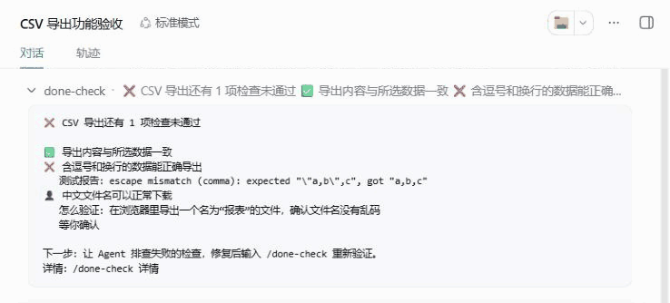

# dsh-done-check

[English](https://github.com/BeforeLanding/dsh-done-check/blob/main/README.md) | 中文

[](https://github.com/BeforeLanding/dsh-done-check/actions/workflows/ci.yml)

为 [DeepSeek Harness](https://github.com/deepseek-ai/deepseek-harness) 编码任务保存可执行的验收清单：每条"已完成"都有真实执行的检查结果，代码变化后旧结果自动标记为需要重验。

> **它能说明什么，不能说明什么**
>
> - "3 项验收中，2 项通过、1 项待人工确认"只表示**约定的检查**的结果，不表示需求已完整实现。插件不显示百分比或"完成度"。
> - 防的是 Agent 随手改写结论：自己宣布测试通过、偷改检查命令、删掉失败项、伪造确认记录。不防拥有不受限 shell 的恶意 Agent，它可以改测试本身，也可以改 DSH home 下的文件。
> - 确认清单不等于授权执行其中的命令。检查命令由当前 DSH 组合的 shell 执行器运行；`bash-local`/`pwsh-local` 不做任何隔离，需要隔离请组合对应的 sandbox 执行器。
> - `watch` 是你声明的范围，不是自动分析出的依赖关系。

## 演示

真实的 DSH Web 流程：**检查通过 → 修改代码 → 旧结果过期 → 重跑失败 → 查看证据**。采集自 DSH 0.1.5-rc.1 和一个 CSV 导出示例仓库，保留完整 DSH 界面，每条完整命令停留 3 秒后再显示结果，压缩执行等待时间。



把 CSV 分隔符从 `,` 改成 `;` 后，旧结果失效。`/done-check run` 抓住回归，`/done-check show export-tests` 展示命令、退出码、执行器、代码指纹和日志。片头的人工结论在录制前已确认；重跑自动检查不会让它重新有效。

[静态预览](https://raw.githubusercontent.com/BeforeLanding/dsh-done-check/main/docs/images/done-check-demo-poster.png) · [MP4 视频](https://github.com/BeforeLanding/dsh-done-check/raw/refs/heads/main/docs/images/done-check-demo.mp4)

## 状态

v0.1.0，早期版本。并在真实的 DSH Web 宿主（0.1.5-rc.1 和 0.2.1-rc.5）上走通了全流程，检查由真实的 `pwsh` 工具在沙箱中执行。支持的 DSH 版本：`>=0.1.5-rc.1 <0.3.0`。设计见 [docs/DESIGN.md](https://github.com/BeforeLanding/dsh-done-check/blob/main/docs/DESIGN.md)。

## 安装

```bash
dsh plugin --profile <你的 profile> add dsh-done-check
```

从源码安装：先 `pnpm install && pnpm build`，再 `dsh plugin --profile <你的 profile> add /path/to/dsh-done-check`。

## 命令与工具

| | 谁用 | 作用 |
|---|---|---|
| `/done-check` | 你 | 状态表 |
| `/done-check confirm` | **仅你** | 确认当前的 `done-check.yaml` |
| `/done-check run [id…]` | 你 | 执行已确认的自动检查 |
| `/done-check pass\|fail <id> [备注]` | **仅你** | 记录人工检查结论 |
| `/done-check show <id>` | 你 | 最近一次的证据：命令、退出码、执行器、指纹、输出末尾 |
| `done_check_draft` | Agent | 校验起草的清单（由 Agent 用自己的文件工具保存） |
| `done_check_run` | Agent | 执行已确认的自动检查 |
| `done_check_status` | Agent | 读取状态 |

无论从哪个入口，每条检查命令都交给你的 DSH 组合中已注册的 shell 工具（`pwsh`/`bash`）执行，所以你的权限规则和审批提示都会生效。被拒绝或无法执行的命令会显示为"未执行"，不记录证据。

## 工作方式

1. 在项目根目录写 `done-check.yaml`（或让 Agent 起草）：

   ```yaml
   version: 1
   task: 新增 CSV 导出功能
   checks:
     - id: export-tests
       name: 导出相关测试通过
       run: pnpm test -- export
       watch: ["src/**", "test/**"]
     - id: typecheck
       name: TypeScript 类型检查通过
       run: pnpm tsc --noEmit
     - id: zh-filename
       name: 中文文件名下载正常
       manual: true
   ```

2. 你用 `/done-check confirm` 确认清单。确认和人工结论只能由你通过命令完成，Agent 做不到。
3. 检查经由 DSH 的 shell 执行器真实运行，记录退出码、输出、耗时和当时的工作区指纹。
4. 工作区内容一变（包括未提交的修改），绑定旧内容的结果就显示为"已过期"，并列出变化的文件；清单里某项被改，该项显示为"清单已改动"；增删检查项或改任务描述，整份清单显示为"结构已变，待确认"。
5. 执行期间工作区或定义发生变化的结果标记为"执行不稳定（须重跑）"，把文件改回去也不能恢复。

## 开发

```bash
pnpm install
pnpm test
```

需要 Node.js ≥ 22.19 和 git。

## 许可证

MIT
